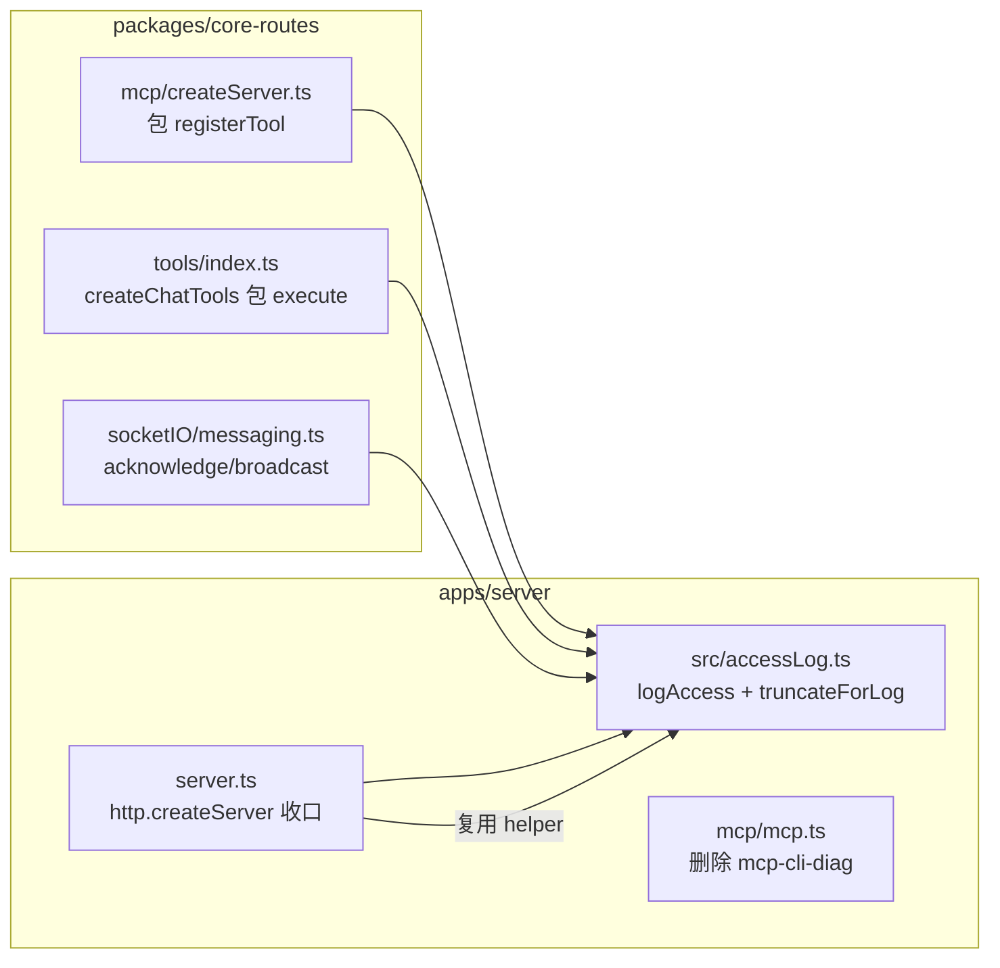

# Access Log(HTTP API / MCP tool / AI tool / Socket.IO)

> Status: **已实现**(2026-10-13 落地;hook 位置以 §2.2 文件表为准。)

## 1. Background

SMM 有四个对外/对内的"调用面",目前没有统一的 access log:

| 调用面 | 现状 |
|---|---|
| HTTP API | 仅个别路由手工调用 `logHttpReqIn/logHttpRespOut`(`apps/server/lib/logger.ts`),不成体系;`server.ts` 中有一行被注释的 `honoLogger()`;core-routes 分发路径完全没有 access 记录 |
| MCP tool | `apps/server/src/mcp/mcp.ts` 有一个 `=== DIAGNOSTIC ===` 的临时 console.log 包装(`[mcp-cli-diag]`),只记 HTTP 层,看不到工具级成败 |
| AI tool | 仅 `doChat` 有零星 debug 日志;AI Agent 一次 chat 循环调用几十个工具,现有日志看不出每个工具的参数/成败/耗时 |
| Socket.IO | `messaging.ts` 的 `acknowledge`/`broadcast` 有散装 `[DEBUG]` 前缀 info 日志,格式与其它面不一致 |

**首要用途:调试排查**。重点是状态、耗时、错误信息,不是审计或 UI 展示。

已评审的技术选型(方案 A):**每个调用面一个统一收口点,共享一份字段规范**。

被否决的备选:

- 方案 B(只在传输层记录):AI chat 是单条长 SSE 请求,传输层看不出工具粒度,与调试目的不符;MCP 需解析 JSON-RPC body + 窥探响应流,更绕。
- 方案 C(Hono 中间件 / `honoLogger`):大多数 API 走 `http.createServer` 的 core-routes 分发,不经过 Hono 中间件栈,覆盖不全。

## 2. Architecture

### 2.1 Project Level Architecture

改动集中在 **`packages/core-routes`**(共享层)与 **`apps/server`**(host 层):



- **HTTP**:helper 放 core-routes(`src/accessLog.ts`),`apps/server/server.ts` 在 `http.createServer` 回调里接线。`apps/ohos` 的 HTTP server 可后续复用同一 helper 接线(本次不接线)。
- **MCP / AI tool / Socket.IO**:hook 均在 core-routes 内部,`apps/ohos` 与 `apps/cli` **零改动自动受益**(前提是 host 传入了 `logger`;未传时静默跳过)。
- 输出走各 host 注入的现有 pino logger(`CoreRoutesLogger` 接口)→ `smm.log` / console,自动经过 `wrapWithMasking` 脱敏。不新增日志文件、不新增写入点。

### 2.2 App Level Architecture

| 文件 | 改动 |
|---|---|
| `packages/core-routes/src/accessLog.ts`(新建) | `logAccess()`、`truncateForLog()`、`serializeErrorForLog()`、`AccessEntry` 类型 |
| `packages/core-routes/src/accessLogHttp.ts`(新建) | HTTP 收口 helper:`attachHttpAccessLog()`、过滤判定 `shouldLogHttpAccess()` |
| `packages/core-routes/src/tools/toolAccessLog.ts`(新建) | AI 工具包装:`withAccessLog()`、`withChatToolsAccessLog()` |
| `packages/core-routes/src/mcp/createServer.ts` | 注册前包装 `server.registerTool`,工具回调外层记 access |
| `packages/core-routes/src/tools/index.ts` | `createChatTools()` 返回前用 `withAccessLog()` 包装每个工具的 `execute` |
| `packages/core-routes/src/socketIO/messaging.ts` | `acknowledge`/`broadcast` 内改为输出 access 条目,移除原散装日志 |
| `apps/server/server.ts` | `http.createServer` 回调接 HTTP access helper |
| `apps/server/src/mcp/mcp.ts` | 删除 `[mcp-cli-diag]` 临时包装(被工具级 access log 取代) |

不改动:`connection.ts` 连接生命周期日志(connect/userAgent/disconnect 已有,非"调用")、`logHttpReqIn/logHttpRespOut`(仍承担 debug 级 body 记录,迁移留作后续清理)、`server.ts` 各路由业务日志。

### 2.3 Key Design

**单一出口 `logAccess(logger, entry)`**(`core-routes/src/accessLog.ts`):

```ts
type AccessSource = "http" | "mcp" | "ai-tool" | "socket.io";

interface AccessEntry {
  source: AccessSource;
  outcome: "ok" | "error";
  durationMs?: number;
  // mcp / ai-tool
  tool?: string;
  args?: unknown;            // 经 truncateForLog 处理
  // ai-tool
  clientId?: string;
  // http
  method?: string;
  path?: string;             // pathname,不含 query
  query?: unknown;           // 仅 debug 开启时输出
  status?: number;
  // socket.io
  kind?: "ack" | "broadcast";
  event?: string;
  data?: unknown;            // 仅 ack;经 truncateForLog 处理
  // 通用
  err?: unknown;             // outcome=error 时的异常摘要
  aborted?: boolean;         // 仅 http;未 finish 即 close
}

// err 的序列化形状:Error → { message, name, stack? };非 Error → { value: String(err) }
// (与 chat.ts 的 serializeError 约定一致)

function logAccess(logger: CoreRoutesLogger | undefined, entry: AccessEntry): void;
```

- `msg` 固定为 `"access"`,作为过滤锚点:`grep '"msg":"access"'` 或 `jq 'select(.msg=="access")'`。
- **永不抛异常**:内部整体 try/catch,logger 缺失时静默 no-op。
- 级别映射见下节;`truncateForLog(value, budget=2000)` 用安全 stringify(循环引用降级为 `"[unserializable]"`),超预算时输出 `{ truncated: true, preview: "<前 2000 字符>" }`。

**hook 模式统一为"包装既有回调"**:MCP 包 `registerTool` 的工具回调,AI tool 包工具对象的 `execute`,HTTP 包 `res` 的 `finish`/`close`,socket.io 在 `acknowledge`/`broadcast` 函数体内直接调用。不在任何路由/工具内部散布 access 调用。

## 3. 日志格式

### 3.1 统一约定

- 每次调用**完成时输出一条** JSON 日志(nginx access log 风格),不拆 req/resp 两条。
- 走现有 pino → `smm.log`(LOG_TARGET=file)或 console,自动过 `wrapWithMasking`。
- 默认 `LOG_LEVEL=info` 下 access 全量可见(除 broadcast),无需开关。

### 3.2 级别映射

| 场景 | outcome | level |
|---|---|---|
| HTTP status < 400 | ok | info |
| HTTP status >= 400 | error | error |
| MCP `isError: false` | ok | info |
| MCP `isError: true` 或回调抛异常 | error | error |
| AI tool execute 正常返回 | ok | info |
| AI tool execute 抛异常 | error | error |
| socket.io ack 成功 | ok | info |
| socket.io ack 超时/失败 | error | error |
| socket.io broadcast | ok | **debug**(固定,不带 data) |

### 3.3 示例

```jsonc
{"level":30,"time":1760300000000,"msg":"access","source":"http","method":"POST","path":"/api/scrape","status":200,"durationMs":1234}
{"level":50,"time":1760300001000,"msg":"access","source":"http","method":"GET","path":"/api/media-metadata","status":404,"outcome":"error","durationMs":5}
{"level":30,"time":1760300002000,"msg":"access","source":"mcp","tool":"get-job","args":{"id":"j-42"},"outcome":"ok","durationMs":45}
{"level":30,"time":1760300003000,"msg":"access","source":"ai-tool","tool":"renameFolder","args":{"path":"D:/media/TvShow"},"clientId":"c-1","outcome":"ok","durationMs":80}
{"level":30,"time":1760300004000,"msg":"access","source":"socket.io","kind":"ack","event":"ask-for-rename-files-confirmation","clientId":"web-abc","data":{"files":[...]},"outcome":"ok","durationMs":1520}
{"level":50,"time":1760300005000,"msg":"access","source":"socket.io","kind":"ack","event":"ask-for-rename-files-confirmation","clientId":"web-abc","err":{"message":"timeout of 5000ms exceeded"},"outcome":"error","durationMs":5000}
{"level":20,"time":1760300006000,"msg":"access","source":"socket.io","kind":"broadcast","event":"scrape-progress","outcome":"ok"}
```

### 3.4 刻意不记录

- 请求/响应 body(access log 保持精瘦;body 由 `logHttpReqIn/Out` 与各路由业务日志承担)。
- 静态资源、`/socket.io/` 轮询、`/api/log` 上报(高频噪音)、`/proxy/*`(仅记内层回环的 `/api/*`)。
- 非工具调用的 JSON-RPC 消息(`initialize`、`tools/list`、notifications)。
- UI 侧前端执行的 frontendTools(后端不可见)。
- socket.io 客户端→服务端事件(当前仅 `userAgent`,已有日志)。

## 4. User Stories

### 4.1 HTTP API 调用被记录

* **Given** - `smm web` 运行中,LOG_LEVEL 为默认 info
* **When** - UI 调用 `POST /api/scrape` 返回 200
* **Then** - `smm.log` 新增一条 `msg="access", source="http", path="/api/scrape", status=200, outcome="ok"` 的 info 日志,含 `durationMs`;不含 query 与 body

### 4.2 MCP 工具失败可见

* **Given** - MCP server 已启动
* **When** - 外部 Agent 调用 `get-job` 且工具返回 `isError: true`
* **Then** - 一条 `source="mcp", tool="get-job", outcome="error"` 的 error 日志,含 `args` 与耗时;`[mcp-cli-diag]` 不再出现

### 4.3 AI 工具调用可按会话追踪

* **Given** - 用户在内置 AI 窗口发起一次重命名会话(clientId=c-1)
* **When** - Agent 依次调用 `getMediaMetadata` → `renameFolder`(后者抛异常)
* **Then** - 两条 `source="ai-tool", clientId="c-1"` 日志;`renameFolder` 为 error 级并带 `err` 摘要

### 4.4 Socket.IO ack 可追踪、broadcast 不刷屏

* **Given** - AI/MCP 触发 `askForRenameFilesConfirmation`,客户端 5s 内未确认
* **When** - `acknowledge` 超时抛错
* **Then** - 一条 `kind="ack", outcome="error"` 的 error 日志;broadcast 类事件仅出现在 LOG_LEVEL=debug

### 4.5 敏感信息不进 info 日志

* **Given** - 某请求 query 携带 `api_key=...`(脱敏黑名单只认 `apiKey` 键名)
* **When** - 请求完成
* **Then** - 条目只有 pathname;`query` 字段仅在 LOG_LEVEL=debug(即 `isDebugEnabled` 为 true)时附加,且仍经 `wrapWithMasking`

## 5. 实现要点

### 5.1 HTTP(apps/server/server.ts)

- 在 `http.createServer` 回调内接线(与 `attachCliHttpTiming` 同层),复用 core-routes 导出的 helper;对 `res` 监听一次 `finish`(正常完成)与 `close`(未 `finish` 即 close → `outcome:"error"`,附 `aborted: true`,status 取 `res.statusCode`)。
- 过滤:pathname 以 `/api/` 开头且 `!== "/api/log"`。core-routes 分发与 Hono 路由由此一并覆盖;MCP 独立端口不经过此服务器,由 5.2 覆盖。
- debug 增强:helper 接受可选 `isDebugEnabled: () => boolean`(apps/server 传 `() => logger.isLevelEnabled("debug")`),为 true 时附加 `query` 字段。

### 5.2 MCP(packages/core-routes/src/mcp/createServer.ts)

- 在 `createMcpStreamableHttpHandler` 内、所有 `register*Tool` 调用前,暂存 `server.registerTool` 并以包装版替换:工具回调计时,结果 `isError` 映射 outcome,异常时记 error 后原样 rethrow。
- 需要一次 TS 断言(`as typeof server.registerTool`)适配 SDK 的重载签名,集中一处并注释原因。

### 5.3 AI tool(packages/core-routes/src/tools/index.ts)

- `withAccessLog(tool, name, { logger, clientId })` 泛型包装:只替换 `execute`,其余字段透传;用 mapped type 保持 `ChatTools` 的精确类型(键类型约束自 `AI_TOOL_REGISTRY`,typo 无法通过编译)。
- 在 `createChatTools()` 的 return 前对整表做一次映射包装,19 个工具零散调用点不改动。
- `logger` 取现有的 `config.logger ?? coreRoutesConfig?.logger`(可能为 undefined,静默跳过);`clientId` 取 `CreateChatToolsArgs.clientId`。

### 5.4 Socket.IO(packages/core-routes/src/socketIO/messaging.ts)

- `acknowledge`:成功/失败两分支各输出一条 `kind:"ack"` 条目(含 `event`、`clientId`、截断 `data`、`durationMs`),替换原发送时 info、成功时 debug、失败时 error 的三条散装日志;超时仍向上抛错(行为不变)。
- `broadcast`:输出 debug 级 `kind:"broadcast"` 条目(仅 `event`),替换原 info 日志。
- `connection.ts` 不动。

## 6. Error Handling

- `logAccess` 整体 try/catch:任何日志构造/序列化失败都不影响调用路径本身。
- `truncateForLog` 安全 stringify:`JSON.stringify` 抛错(循环引用等)时降级为 `"[unserializable]"` 字符串。
- 包装层语义:所有包装(MCP 回调、AI execute、ack)失败时**原样 rethrow 原异常**,不吞不换。
- HTTP aborted:未 `finish` 即 `close` 记 `outcome:"error"` + `aborted: true`,不计入 status 语义。

## 7. Testing

单元测试(core-routes,`*.test.ts` 与源码同目录,沿用现有 Vitest 约定):

| 被测 | 用例 |
|---|---|
| `accessLog.test.ts` | `truncateForLog`:小对象透传 / 超预算降级 truncated / 循环引用不抛;`logAccess`:ok→info、error→error、broadcast→debug、logger 缺失 no-op、logAccess 自身不抛 |
| MCP 包装 | 经 `createMcpStreamableHttpHandler`(stub config + fake logger)验证:成功→info `outcome:ok`;`isError:true`→error;回调抛→error 且异常原样穿透 |
| `withAccessLog` | execute 正常→info 含 args/clientId;抛→error 含 err;非 execute 字段透传、类型不变 |
| HTTP helper | mock req/res:命中过滤(记)、`/api/log` 与非 `/api/`(不记)、finish 正常条目、close-before-finish → aborted;`isDebugEnabled=true` 时含 query |
| `messaging.ts` | fake io/socket:ack 成功/超时各产出对应条目;broadcast 为 debug 且无 data |

现有 e2e(`apps/e2e/mcp` 等)不新增断言;后续如需可在 mcp e2e 中校验 smm.log 的 access 行。

## 8. Out of Scope

- `logHttpReqIn/logHttpRespOut` 及散装路由日志的迁移清理(后续独立 PR)。
- `apps/ohos` HTTP access 接线(helper 已就位,仅需 ohos 侧调用)。
- 用户可见的操作历史 UI、独立 access.log 文件、审计语义(不可抵赖/防篡改)。
- frontendTools(UI 侧执行)的日志。
