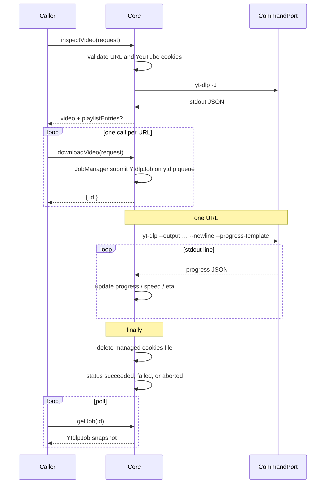
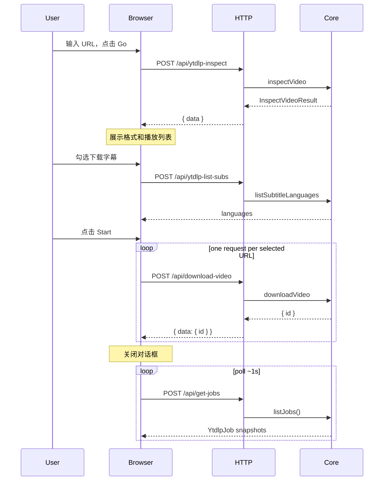
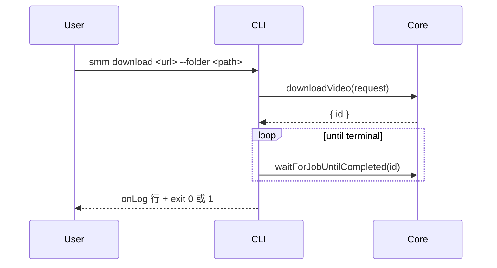

# Download Video

**Supported Platform** Web UI, CLI, Electron

把视频下载的业务实现收进 `apps/core`，做成 `AbstractJob` 的子类 `YtdlpJob`。Web UI 和 `smm` CLI 只收集用户输入、调用 Core、展示任务状态。yt-dlp 的参数、探测、下载、进度、错误分类、Cookies 文件生命周期不再留在 UI 或 `JobOrchestrator`。

交互行为仍以 [Download Video Dialog](../superpowers/design/download-video-dialog.md) 为准：URL 只校验 http/https，Go 执行一次 `yt-dlp -J`，Start 才开始下载，YouTube 必须有 Cookies，代理写入 `UserConfig.ytdlpProxy`。

### 实施阶段

- **第一阶段（已完成）**：`apps/core`（`CommandPort`、`YtdlpJob`、`inspectVideo` / `downloadVideo`）+ `apps/server` 的 `CommandPort` 适配器 + `smm download`。
- **第二阶段（已完成）**：`POST /api/ytdlp-inspect`、`/api/download-video`、`/api/get-jobs`，以及 DVD / 后台任务弹层切换到 Core Job。

## 已确认的决定

1. **探测不是 Job。** Go 必须等格式和播放列表返回后，用户才能选清晰度和分集。`core.inspectVideo()` 是一次请求-响应。`YtdlpJob` 只负责 Start 之后的下载。
2. **一个 URL 一个 `YtdlpJob`。** Start 勾选了多个地址时，调用方对每个 URL 各调一次 `downloadVideo`。没有父 Job，也没有 `entries`。`ytdlp` 队列并发为 1，这些 Job 会排队逐个执行。停掉其中一个不会停掉其余的。
3. **进程启动留在宿主，业务留在 Core。** 新增可选的 `CommandPort`。`apps/server` 的实现复用现有 `apps/server/src/utils/cmd.ts`（PTY、`--ffmpeg-location`、进度参数注入），不重写 spawn。
4. **下载不占用导入队列。** `JobManager` 现有队列并发 1、超时 5 分钟。下载走单独的 `ytdlp` 队列，并发 1，超时 1 小时，避免一次下载堵住 `importFolder`。
5. **Cookies 正文交给 Core。** UI 不再自己写 Cookies 文件。每个 Job 各自写入一份受管文件，该 Job 结束时删除自己的那一份。`--cookies-from-browser` 仍只传浏览器名。
6. **错误分类进 Core，文案留在 UI。** Core 快照带稳定的 `errorType`。UI 用现有 i18n 映射成提示。
7. **`JobOrchestrator` 只删 `download-video` 分支。** 转写、ffmpeg 等任务仍走 IndexedDB。

## 现状（落地后）

| 职责 | 所在 |
|------|------|
| URL / YouTube Cookies 规则 | `apps/core` validators；UI 表单再拦一层 |
| `yt-dlp` 参数 / 格式预设 | `apps/core/src/whitelistedCmd/ytdlp.ts` |
| 探测（`-J`） | `core.inspectVideo` → `POST /api/ytdlp-inspect`；UI DVD Go |
| 下载 / 进度 / 停任务 | `YtdlpJob` + `ytdlp` 队列；`POST /api/download-video`、`get-job`、`stop-job` |
| 进度 JSON / `test.local` / 错误分类 | `@smm/core`（`pipeline/ytdlp/*`）；server `cmd.ts` / UI 仅 re-export 或映射文案 |
| CLI | `smm download`（含 `--print-progress-only`） |
| 后台任务弹层 / 音乐面板下载行 | 读 Core `YtdlpJob` 快照（Zustand），不再经 IndexedDB 执行下载 |

转写、ffmpeg 等仍走 `JobOrchestrator` + IndexedDB（不在本次范围）。

## apps/core



`downloadVideo` 在 Job 入队后立即返回。调用方轮询 `getJob`，直到 `succeeded`、`failed` 或 `aborted`。日志不在快照里，用 `getJobLog(id)` 读取。停止用现有 `stopJob(id)`。

### Core 方法

```ts
interface YtdlpCommonRequest {
  /** Netscape Cookies 正文。Core 写入受管文件，不由调用方传路径。 */
  cookiesText?: string
  /** `--cookies-from-browser`，仅 chrome / edge / firefox 等已允许的名字。 */
  cookiesFromBrowser?: string
  jsRuntime?: string
  jsRuntimePath?: string
  /** 缺省时不读 UserConfig；调用方把输入框里的值传进来。 */
  proxy?: string
  /**
   * bgutil HTTP POT provider 根地址。
   * 非空时追加 `--extractor-args youtubepot-bgutilhttp:base_url=<url>`。
   */
  potProviderUrl?: string
}

interface InspectVideoRequest extends YtdlpCommonRequest {
  url: string
}

interface InspectVideoResult {
  /** 单视频，或播放列表的第一条，供格式选择。 */
  video: VideoMetadata
  /** `yt-dlp -J` 返回 playlist 时的完整 entries。 */
  playlistEntries?: VideoMetadata[]
}

interface DownloadVideoRequest extends YtdlpCommonRequest {
  folder: string
  /** 这一条 Job 要下载的地址。 */
  url: string
  /** 展示用标题。缺省时 UI 用 URL。 */
  title?: string
  /** preset id，或用户选中的 format code 拼出的 `-f` 字符串。 */
  format?: string
  /** 仅允许 `YTDLP_DOWNLOAD_ALLOWED_ARGS` 里的开关。 */
  extraArgs?: string[]
  /** 选中的字幕语言。空或不传表示只下视频。`both` 同时写手动和自动字幕。arm64 上传入非空列表会被拒绝。 */
  subtitleLangs?: { code: string; kind: "manual" | "auto" | "both" }[]
}

interface DownloadVideoHandle {
  id: string
}
```

- `inspectVideo(request): Promise<InspectVideoResult>`
- `downloadVideo(request): Promise<DownloadVideoHandle>`
- `listJobs(): Job[]` — 内存中的全部 Core Job，含 `YtdlpJob`
- 已有：`getJob(id)`、`getJobLog(id)`、`stopJob(id)`、`waitForJobUntilCompleted(id)`

校验失败抛错，HTTP 层转成 `{ error: "Error Reason: …" }`。规则：

- `validateDownloadUrl`：空 URL、非 http/https 拒绝。不检查站点白名单。
- YouTube（`isYoutubeDownloadUrl`）：`cookiesText` 与 `cookiesFromBrowser` 至少有一个。探测和下载都检查。
- `folder` 非空。Core 不创建目录；目录不存在时由 yt-dlp 失败，Job 标为 `failed`。
- `url` 再走一次 `validateDownloadUrl`。
- `extraArgs` 走现有 `validateYtdlpDownloadExtraArgs`。

`VideoMetadata` 从 `apps/ui/src/api/ytdlp/types.ts` 迁到 `apps/core`，解析函数从 `apps/ui/src/api/ytdlp/parse.ts` 迁到 `apps/core/src/pipeline/ytdlp/parse.ts`。格式预设（`default` / `best` / `1080p` / `720p` / `audio` 以及 format code 拼接）从 `apps/ui/src/lib/ytdlpFormatPresets.ts` 迁到 `apps/core/src/whitelistedCmd/ytdlp.ts`。UI 只保留预设 id 到 i18n key 的映射。

### YtdlpJob

`apps/core/src/jobs/YtdlpJob.ts`，`type` 为 `"ytdlp"`。

`toJSON()` 返回：

```ts
interface YtdlpJobSnapshot {
  kind: "ytdlp"
  id: string
  type: "ytdlp"
  url: string
  title?: string
  folder: string
  status: JobStatus
  /** 这一条下载的进度。0–100。 */
  progress: number
  speedBps?: number
  etaSeconds?: number | null
  errorType?: string
  error?: string
  createdAt: number
  updatedAt: number
}
```

`Job` 联合类型加上 `YtdlpJobSnapshot`。

`run()` 只下载 `url` 这一条：

1. 若已 `requestToAbort`，状态改为 `aborted` 并返回。
2. 若有 `cookiesText`，写入这份 Job 自己的受管 Cookies 文件（沿用 Core 里已有的 Cookies 路径规则）。同一轮 Start 里的其他 Job 各写各的文件。
3. spawn 一次下载。参数用现有 `buildYtdlpDownloadArgs`，并附上现有进度模板：`--newline` 加 `--progress-template`（模板字符串与 `apps/server/src/utils/cmd.ts` 的 `YTDLP_PROGRESS_TEMPLATE` 相同，常量挪到 Core）。
4. stdout 每一行尝试按进度 JSON 解析。解析成功则更新本 Job 的 `progress`、`speedBps`、`etaSeconds`。原始行追加到 Job 日志。
5. 退出码 0：保持 `running`，交给 `AbstractJob.start` 写成 `succeeded`。非 0：`classifyYtdlpError` 得到 `errorType`，状态改为 `failed`。不删除已经落盘的文件。
6. `finally` 删除这份 Job 的受管 Cookies 文件。队列里还没跑的 Job 不受影响。

`abort()` 中止当前这次 `CommandPort.run`。`JobManager.tryAbort` 改为先 `tryAbort()` 再调用 `abort()`。`ImportFolderJob.abort()` 保持空实现，导入仍只在步骤边界协作式停止。

`https://test.local/{extractor}/http/{status}` 的模拟从 `cmd.ts` 挪到 Core。`YtdlpJob` 和 `inspectVideo` 在调用 `CommandPort` 之前识别该 URL，直接返回模拟错误，不启动进程。查询串形式 `?extractor=&status_code=` 不实现；现有测试用的是路径形式。

### CommandPort

```ts
interface CommandRunRequest {
  command: "yt-dlp"
  args: string[]
  onStdoutLine?: (line: string) => void
  onStderrLine?: (line: string) => void
}

interface CommandRunResult {
  exitCode: number
  stdout: string
  stderr: string
}

interface CommandPort {
  run(request: CommandRunRequest, signal: AbortSignal): Promise<CommandRunResult>
}
```

`PlatformPorts.command` 可选。`inspectVideo` / `downloadVideo` 在端口缺失时抛错。OHOS 不接这个端口，因此不在本次支持范围内。

`apps/server` 增加适配器，内部调用现有 yt-dlp spawn（含 PTY 与 ffmpeg location）。适配器由 `getCore` 注入，CLI 和 `smm web` 共用。

### JobManager

`submit(job, options?)` 增加：

- `queue: "default" | "ytdlp"`，默认 `"default"`
- `timeoutMs`，默认仍为构造时的 5 分钟

`downloadVideo` 使用 `queue: "ytdlp"`、`timeoutMs: 60 * 60 * 1000`。两条队列各自并发 1，共用同一个 `jobs` Map，因此 `getJob` / `listJobs` / `stopJob` / `waitForJobUntilCompleted` 不用区分队列。

## Web UI 与 Electron

Electron 复用同一套 UI，经本机 HTTP 访问 Core。对话框组件保留：协议勾选、URL、Cookies、格式、分集勾选、代理、目录选择、More options。这些状态不到 Core。



用户打开后台任务日志时，沿用导入任务的 `POST /api/get-job-log`。进度条读该 Job 快照的 `progress` / `speedBps` / `etaSeconds`，不再轮询命令日志。

新增路由，响应形状与 `POST /api/import-folder` 相同（`{ data } | { error }`，业务失败也是 HTTP 200）：

- `POST /api/ytdlp-inspect`
- `POST /api/ytdlp-list-subs`
- `POST /api/download-video`
- `POST /api/get-jobs` → `{ data: { jobs: Job[] } }`

`POST /api/get-job` 对 `YtdlpJob` 走 `toJSON()`。

UI 改动：

- `use-ytdlp-download-flow` 的 Start 对每个选中 URL 各调一次 `download-video`，不再 `createJob` 写入 IndexedDB。某一个请求失败时，已经入队的 Job 保留，对话框提示这次失败的 URL。
- 格式列表改为调用 `ytdlp-inspect`，删除对话框路径上的 `executeYtdlp`。
- `JobOrchestratorProvider` 删除 `download-video` 分支。
- 后台任务弹层同时显示 IndexedDB 里剩余的任务和 `get-jobs` 里的 `kind: "ytdlp"`。停止下载调用 `POST /api/stop-job`。
- 音乐面板里“下载中”的行改为读 `YtdlpJob` 快照，不再读 IndexedDB 的 download job。

代理输入框仍通过现有配置接口写入 `UserConfig.ytdlpProxy`。Go 和 Start 把当前输入值放进请求体，不让 Core 再读配置。

Cookies 指南测速（`POST /api/speedtest`）留在 UI，与下载 Job 无关。

## CLI

```bash
smm download <url> --folder <path> [--format default|best|1080p|720p|audio|<code>] [--proxy <url>] [--cookies-from-browser <name>] [--cookies <file>] [--sub-langs en,zh-Hans] [--print-progress-only] [--verbose]
```

`--format` 缺省为 `default`（不传 `-f`）。`--cookies <file>` 由 CLI 读出文件正文再交给 `cookiesText`，Core 仍负责写入受管副本并在结束后删除。YouTube 且没有 Cookies 时，命令直接失败退出，不启动 Job。`--sub-langs` 把逗号分隔的语言交给 `subtitleLangs`，每条都按 `both` 传递，因此同时加上 `--write-subs` 和 `--write-auto-subs`。arm64 上 `--sub-langs` 会失败退出，对话框也不提供下载字幕。

`--print-progress-only` 只向 stdout 打印 `YtdlpJob` 快照行（`progress percent=… speedBps=… etaSeconds=…`），不打印 yt-dlp 日志。用于 e2e 断言宿主 `CommandPort` 把 `runCommand` 的 `sink.progress` 正确转回可解析行、Core 能更新进度。



实现方式对齐 `smm add`：`callbacks.onLog` 打到 stdout，结束后看 `job.status`。没有单独的 inspect 子命令。要看任务用现有 `smm job` / `smm job log` / `smm job stop`。

## 文件

| 动作 | 路径 |
|------|------|
| 新增 | `apps/core/src/ports/CommandPort.ts` |
| 新增 | `apps/core/src/jobs/YtdlpJob.ts`、`YtdlpJob.test.ts` |
| 新增 | `apps/core/src/pipeline/ytdlp/parse.ts`、`classifyYtdlpError.ts`、`testLocal.ts` |
| 修改 | `apps/core/src/jobs/jobManager.ts`（第二条队列、`tryAbort` 调用 `abort()`） |
| 修改 | `apps/core/src/jobs/types.ts`（`YtdlpJobSnapshot`，加入 `Job`） |
| 修改 | `apps/core/src/Core.ts`（`inspectVideo`、`downloadVideo`、`listJobs`） |
| 修改 | `apps/core/src/types.ts`（可选 `command` 端口） |
| 修改 | `apps/core/src/whitelistedCmd/ytdlp.ts`（格式预设、进度模板参数） |
| 新增 | `apps/server` 的 `CommandPort` 适配器，接入 `getCore` |
| 新增 | `apps/server/src/route/YtdlpInspect.ts`、`DownloadVideo.ts`、`GetJobs.ts` 及对应测试 |
| 修改 | `apps/server/src/route/GetJob.ts`（序列化 `YtdlpJob`） |
| 新增 | `apps/cli/src/cli/commands/download.ts`，在 `runCli.ts` 注册 |
| 修改 | 下载对话框的 Go / Start、后台任务弹层、音乐面板下载行 |
| 删除调用 | `JobOrchestratorProvider` 的 `download-video` 分支；对话框不再调用 `executeYtdlp` |

`apps/server/src/utils/cmd.ts` 里的 spawn、PTY、ffmpeg location 保留，由 `CommandPort` 适配器调用。进度解析、`test.local`、错误分类以 Core 为准；`cmd.ts` / UI 只 re-export 或做展示映射，避免两套实现。

## 不在本次范围

- 转写、翻译、ffmpeg 任务仍由 `JobOrchestrator` 和 IndexedDB 执行。
- 不把 Job 持久化到磁盘。进程退出后任务消失，与导入任务相同。
- 不支持 OHOS 下载（没有 `CommandPort`）。
- 不改对话框布局，不恢复“下载分集 / 获取视频列表”勾选框。
- 不改 Cookies 指南的镜像测速。
- 失败或中止不删除已经下完的视频文件。

## Test

Core 单测（不启动真实 yt-dlp）：

- `inspectVideo` 拒绝空 URL、非 http(s)、YouTube 缺 Cookies。
- `test.local` 路径返回模拟错误，`CommandPort.run` 不被调用。
- 一个 `YtdlpJob` 只 spawn 一次。退出码非 0 时该 Job 为 `failed`，Cookies 文件仍被删除。
- 连续两次 `downloadVideo` 得到两个 id，在 `ytdlp` 队列上先后执行。中止第一个不会把第二个标为 `aborted`。
- 进度行更新该 Job 的 percent / speed / eta。
- `abort()` 令进行中的 `run` 收到 `AbortSignal`，该 Job 状态为 `aborted`。
- `downloadVideo` 入 `ytdlp` 队列，不占用 default 队列的 5 分钟超时。

HTTP：`ytdlp-inspect`、`download-video` 返回 `{ data: { id } }`，`get-job` 的 `kind` 为 `ytdlp`，`stop-job` 能中止。

CLI：`smm download` 在假 Core 端口下等到 `succeeded` 后退出码 0，失败退出码 1；`--print-progress-only` 仅输出 `progress percent=` 行。

UI：对话框 Start 按选中 URL 的数量调用 `download-video`，不写 IndexedDB。后台任务弹层按条渲染 `YtdlpJob` 的进度和停止。E2E（`MusicPanel-Download-UrlProbing`）通过页面 `fetch` 拦截 `POST /api/ytdlp-inspect`，不再用 `localStorage` 伪造 `-J`。CLI e2e：`smm download … --print-progress-only` 断言 stdout 出现 `progress percent=` 且至少一次 `> 0`。

## 实施顺序

1. ~~Core：`CommandPort`、解析、错误分类、`test.local`、格式预设。~~（第一阶段已完成）
2. ~~`YtdlpJob`、`inspectVideo`、`downloadVideo`、第二条队列。~~（第一阶段已完成）
3. ~~`apps/server` `CommandPort` 适配器 + `smm download`。~~（第一阶段已完成）
4. ~~HTTP 路由和 `get-job` / `get-jobs` 序列化。~~（第二阶段已完成）
5. ~~UI 切到新路由，删掉 `download-video` 的 IndexedDB 执行路径，弹层和音乐面板改读快照。~~（第二阶段已完成）
6. ~~更新 [Job Management](./job.md)：补上 `ytdlp` 队列、`POST /api/get-jobs`，并写明 External Command Job 已由 `YtdlpJob` 落地。~~（第二阶段已完成）

可用路径：`smm download`、`POST /api/ytdlp-inspect`、`POST /api/download-video`、DVD Go/Start（经 Core）。

## References

[Download Video Dialog 设计](../superpowers/design/download-video-dialog.md)
[Import Folder](./import-folder.md)
[Job Management](./job.md)
[Job Definition](../../apps/core/src/jobs/types.ts)
[AbstractJob](../../apps/core/src/jobs/abstract-job.ts)
