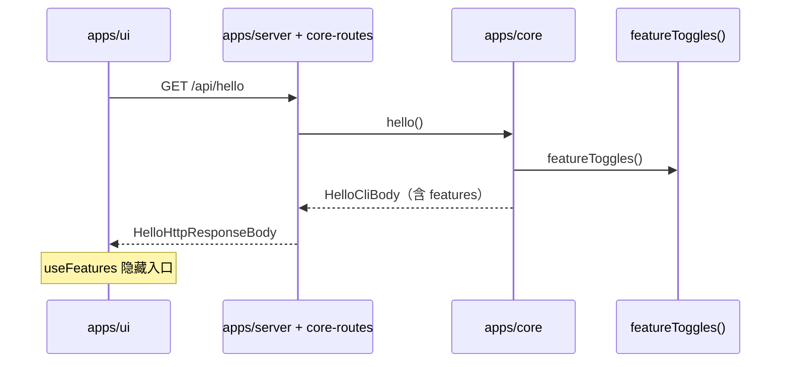

# Feature toggles（yt-dlp / VideoCaptioner）

用 hello 下发的功能开关，在界面上隐藏 yt-dlp 与 VideoCaptioner。HTTP 与 CLI 不读这两个开关。

细部行为仍以 [hello](./hello.md)、[Download Video Dialog](../superpowers/design/download-video-dialog.md) 与 [HarmonyOS integration](../superpowers/design/harmonyos-integration.md) 为准。开关打开时，这些功能的行为不变。

## 1. Background

yt-dlp（下载视频）和 VideoCaptioner（转写 / 翻译 / 合成 / 处理字幕）只要平台允许就会出现在界面上。需要服务端在启动握手里声明它们是否对用户可见。

| 机制 | 作用 | 与本开关的关系 |
|------|------|----------------|
| `GET /api/hello` 的 `subtitleDownloadSupported` | arm64 上关闭「下载字幕」 | 保留。只在下载对话框能够打开时有意义 |
| `useFeatures()` 的 HarmonyOS 分支 | 鸿蒙上隐藏下载、字幕、转码等 | 保留，与 hello 开关取与 |
| `useFeatures()` 的 localStorage 开关 | AI、布局、yt-dlp 调试参数等用户偏好 | 不承载这两个产品开关 |

初始值为关闭：

```json
{
  "features": {
    "ytdlp": false,
    "videocaptioner": false
  }
}
```

## 2. Architecture

### 2.1 Project Level Architecture

`featureToggles()` 在 `@smm/types/featureToggles`。`Core.hello()` 写入该结果。`doHello()` 在 options 已带 `features` 时原样转发，否则补上 `featureToggles()`。鸿蒙的 `buildHelloConfig()` 不单独写这份字段，`/api/hello` 仍经过 `doHello()`，所以响应里同样有 `features`。UI 在启动时已有的 `GET /api/hello` 里读取它。



### 2.2 App Level Architecture

`HelloCliBody.features` 为必填：

```typescript
interface HelloFeatures {
  ytdlp: boolean
  videocaptioner: boolean
}
```

`featureToggles()` 固定返回 `{ ytdlp: false, videocaptioner: false }`。不读环境变量，不读用户配置。

`apps/ui` 的 `useFeatures()` 与现有平台判断取与。hello 尚未写入缓存，或 `features` 缺字段时，对应开关视为 `false`。

| `useFeatures` 标志 | 条件 |
|--------------------|------|
| `isDownloadVideoEnabled` | 非鸿蒙 **且** `features.ytdlp === true` |
| `isSubtitleFeaturesEnabled` | 非鸿蒙 **且** `features.videocaptioner === true` |
| `isTranscribeEnabled` | 字幕开关为真 **且** 运行平台不是 `darwin` |

已有入口读这些标志：

- yt-dlp：菜单「下载视频」、欢迎页卡片、音乐面板下载按钮、设置里的 yt-dlp 路径
- VideoCaptioner：剧集 / 电影 / 音乐的字幕菜单与流水线、状态栏 VideoCaptioner 提示、设置里的 VideoCaptioner 路径与「使用内置 FFmpeg」

FFmpeg 转码 / 压缩保持原样。`features` 为 false 时不拦截 HTTP 或 CLI。

`smm hello` 文本增加 `yt-dlp: yes/no` 与 `VideoCaptioner: yes/no`。`-f json` 带 `features`。

### 2.3 Key Design

- 一份默认值。`Core.hello()` 和 `doHello()` 的缺省都来自 `featureToggles()`。
- 缺省即关。hello 到达前界面不闪出入口。
- 与平台能力叠加。鸿蒙、macOS 转写限制、arm64 字幕下载限制保持原样。
- 腾讯 ASR 的 HTTP 不改。字幕菜单在 `videocaptioner` 为 false 时整个隐藏，因此界面上没有腾讯 ASR 入口。

## 3. User Stories

### 3.1 Hello 返回 features

* **Given** 进程按当前产品默认启动
* **When** 调用方执行 `GET /api/hello`、`smm hello` 或 `smm hello -f json`
* **Then** 响应含 `features.ytdlp === false` 与 `features.videocaptioner === false`；CLI 文本有对应的 yes/no 行。鸿蒙 `/api/hello` 走 `doHello()`，结果相同

受影响规格：[docs/dev/hello.md](./hello.md)。

受影响测试：`apps/core/src/Core.test.ts`、`packages/core-routes/src/hello.test.ts`、`packages/core-routes/src/core-routes.test.ts`、`apps/cli/src/cli/helloFormat.test.ts`、`apps/cli/src/cli/hello.test.ts`、`packages/types/featureToggles.test.ts`。

### 3.2 UI 按 hello 隐藏入口

* **Given** hello 缓存里两个开关都是 false，或 hello 尚未返回
* **When** 用户查看菜单、欢迎页、音乐面板、字幕菜单、状态栏和外部程序设置
* **Then** 下载视频与 VideoCaptioner 相关入口不出现；转码、压缩、导入文件夹仍在
* **Given** hello 里对应开关为 true，且不是鸿蒙
* **When** 用户查看上述界面
* **Then** 这些入口按原来的平台规则出现

受影响测试：`apps/ui/src/hooks/useFeatures.test.ts`、`apps/ui/src/components/StatusBar.test.tsx`。

界面 e2e 在 `featureToggles()` 为 false 时跳过，开关改为 true 后会再跑：

- 下载：`MusicPanel-Download.e2e.ts`、`MusicPanel-Download-UrlProbing.e2e.ts`、`MusicPanel-Download-Agreement.e2e.ts`
- VideoCaptioner：`common/videocaptioner/*.e2e.ts`、`MusicPanel-Transcribe.e2e.ts`、`manual/Transcribe.e2e.ts`、`Subtitle.e2e.ts`

设置页 e2e 在 `ytdlp` 为 false 时只断言 FFmpeg 与 QuickJS。CLI e2e 不跳过，因为命令行仍然可用。

## 4. 不在本 epic 内

- 用环境变量、远程配置或设置页修改开关
- 在 HTTP 或 CLI 拒绝 yt-dlp / VideoCaptioner
- 关闭 FFmpeg 转码 / 压缩
- 删除 yt-dlp、VideoCaptioner 的实现、打包或 CI 下载
