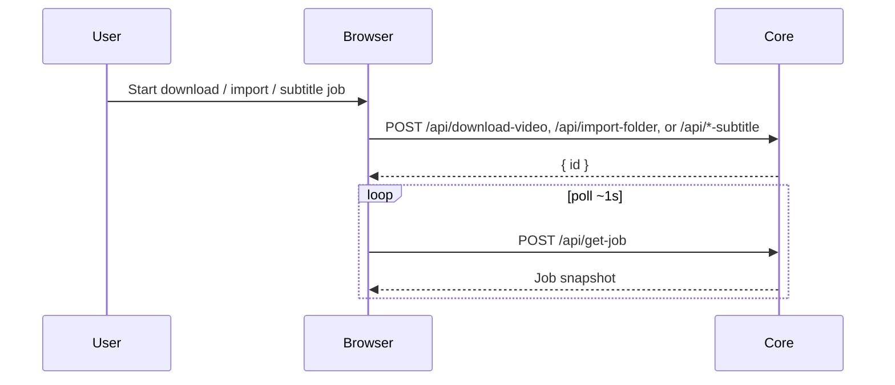

# Job Management

**Supported Platform** CLI, Web UI, Electron, ohos


## Concepts

**External Command Job** The job representing an external command. The log is stdout/stderr (and progress lines) written by the job. Download video via yt-dlp is implemented as Core `YtdlpJob`. Videocaptioner subtitle jobs (`TranscribeSubtitleJob`, `TranslateSubtitleJob`, `SynthesizeSubtitleJob`, `ProcessSubtitleJob`) share the `videocaptioner` queue. FFmpeg conversion still runs in the UI JobOrchestrator / IndexedDB path.

**Internal Job** The job representing an internal job, such as importing a folder or scraping metadata. The log of the job is reported by the internal job via `appendLog`.

**Abortable Job** A job that can be stopped. Import jobs abort cooperatively at stage boundaries. `YtdlpJob` aborts by signalling the underlying `CommandPort.run` `AbortSignal`.

Jobs live in the Core process that created them (in-memory). They are not persisted.


## Core

`JobManager` runs three queues:

| Queue | Concurrency | Default / per-submit timeout | Used by |
|-------|-------------|------------------------------|---------|
| `default` | 1 | 5 minutes | import-folder, import-library, scrape |
| `ytdlp` | 1 | 1 hour (per submit) | `YtdlpJob` |
| `videocaptioner` | 1 | per-submit (see below) | all videocaptioner subtitle jobs |

`videocaptioner` queue per-submit timeouts:

| Kind | JobManager `timeoutMs` |
|------|------------------------|
| `transcribe-subtitle` / `translate-subtitle` | 10 minutes |
| `synthesize-subtitle` | 1 hour |
| `process-subtitle` | 2 hours |

Server `VideoCaptionerPort` uses a hard command timeout of **≥ 2 hours** so a long process is not killed by the Port before the JobManager deadline.

All queues share the same `jobs` Map, so `getJob` / `listJobs` / `stopJob` / `waitForJobUntilCompleted` do not need a queue argument.

```
core.importFolder(path, type)     → { id }
core.downloadVideo(request)       → { id }   // YtdlpJob on ytdlp queue
core.transcribeSubtitle(request)  → { id }   // TranscribeSubtitleJob on videocaptioner queue
core.translateSubtitle(request)   → { id }   // TranslateSubtitleJob on videocaptioner queue
core.synthesizeSubtitle(request)  → { id }   // SynthesizeSubtitleJob on videocaptioner queue (1h)
core.processSubtitle(request)     → { id }   // ProcessSubtitleJob on videocaptioner queue (2h)
core.inspectVideo(request)        → InspectVideoResult  // not a Job
core.getJob(id)                   → Job snapshot (no log body)
core.listJobs()                   → Job[]
core.getJobLog(id)                → log text / lines
core.stopJob(id)                  → void (tryAbort on pending/running)
```

`getJob` does not include logs. `YtdlpJob` snapshots include `progress` / `speedBps` / `etaSeconds`. Subtitle job snapshots (`kind`: `transcribe-subtitle` | `translate-subtitle` | `synthesize-subtitle` | `process-subtitle`) include `progress` and optional `error`. Process snapshots omit `llm` secrets (`apiKey` / `apiBase` / `model`). Failed or aborted download jobs do not delete already-written video files.

See [Download Video](./download-video.md) and [Core JobManager design](../superpowers/specs/2026-09-15-core-job-manager-design.md).


## HTTP

Web UI, Electron, and ohos talk to the long-lived CLI/Electron server:

```
POST /api/get-jobs     {}              → { data: { jobs } }
POST /api/get-job      { id }          → Job snapshot
POST /api/get-job-log  { id }          → { lines } / text
POST /api/stop-job     { id }          → { id }
POST /api/ytdlp-inspect { url, … }     → InspectVideoResult
POST /api/download-video { url, folder, … } → { data: { id } }
POST /api/transcribe-subtitle { folder, mediaPath, asr, … } → { data: { id } }
POST /api/translate-subtitle { folder, subtitlePath, translator, targetLanguage, … } → { data: { id } }
POST /api/synthesize-subtitle { folder, videoPath, subtitlePath, … } → { data: { id } }
POST /api/process-subtitle { folder, mediaPath, … } → { data: { id } }
```

Web UI polls `get-job` (~1s) for import, ytdlp, and subtitle job status (Core job snapshots via `POST /api/get-job`, not command-log polling). Download progress comes from the `YtdlpJob` snapshot. Subtitle progress comes from Core subtitle job snapshots (`transcribe` / `translate` / `synthesize` / `process`). Logs use `POST /api/get-job-log`.


## CLI

```bash 
smm job <job-id>       # print job status
smm job log <job-id>   # print log messages, one per line
smm job stop <job-id>  # abort the job
smm download <url> --folder <path>   # enqueue YtdlpJob and wait
smm transcribe <media> --folder <path> [--asr bijian|jianying|whisper-cpp] …  # enqueue TranscribeSubtitleJob and wait
smm translate <subtitle> --folder <path> --translator bing|google|llm --target-language <lang> …  # enqueue TranslateSubtitleJob and wait
smm synthesize <video> -s <subtitle> --folder <path> [--subtitle-mode soft|hard] [--quality …] …  # enqueue SynthesizeSubtitleJob and wait
smm process <media> --folder <path> [--asr …] [--no-translate] [--no-synthesize] …  # enqueue ProcessSubtitleJob and wait
```

No generic start command. Jobs are created by commands such as `smm add <folder>`, `smm download`, `smm transcribe`, `smm translate`, `smm synthesize`, or `smm process`.

`smm job*` talks to in-process Core (same as today). A second CLI process cannot see or stop a job from `smm add` or from the HTTP server. To stop a job started via UI/HTTP, call `POST /api/stop-job` against that server.

## Web UI, Electron, ohos



## References

[Supported Platform](./supported-platform.md)
[Import Folder](./import-folder.md)
[Download Video](./download-video.md)
[Job Definition](../../apps/core/src/jobs/types.ts)
[Core JobManager design](../superpowers/specs/2026-09-15-core-job-manager-design.md)
