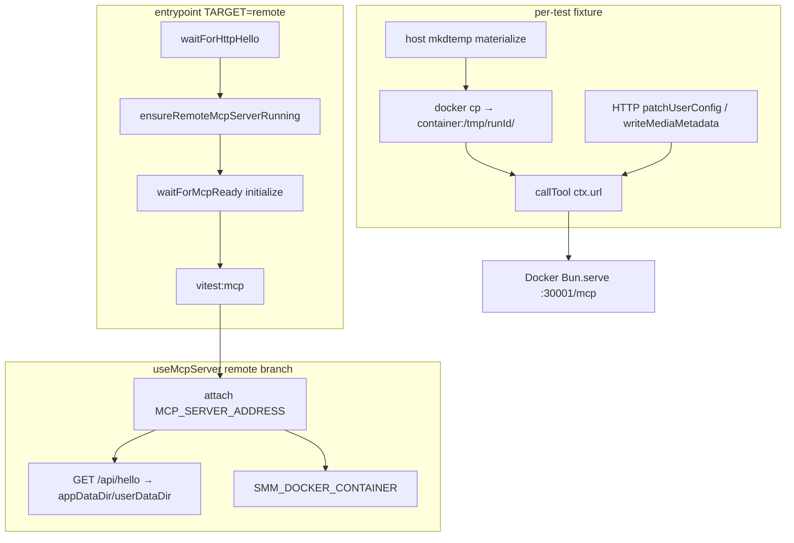
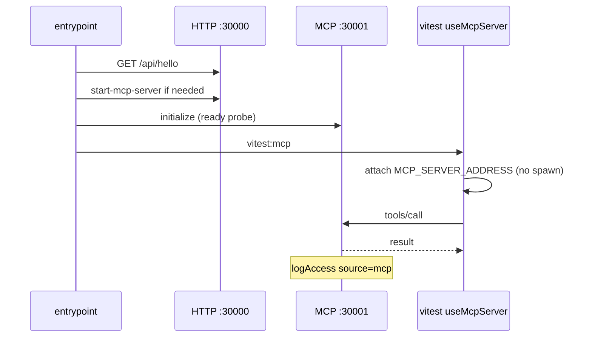

# MCP remote e2e — hit remote server, not local CLI

This design document describe the high level design of a feature.
The design document is golden source and reference by one or more features.

## 1. Background

`pnpm test:mcp:remote` (`TARGET=remote`) is meant to validate the **user scenario** where SMM is already running on a remote host (Docker container or `smm web` + MCP started via UI/`smm mcp start`), and an external MCP client talks to `MCP_SERVER_ADDRESS`.

**Bug:** `entrypoint.ts` correctly ensures the remote MCP is running and waits for it, but every Vitest case uses `useMcpServer()` → `startMcpServer()`, which **spawns a local** `apps/cli/dist` MCP on an ephemeral port. Tool calls never reach the Docker/remote process. Container logs therefore show no `"source":"mcp"` access entries even when all tests pass.

Local `dev` / `cli` targets remain valid for isolated CLI binary testing; only `remote` must stop spawning a second MCP.

Constraints agreed in design review:

- Seed **config / metadata** via HTTP API (+ Bearer), not by writing container config dirs from the host.
- Seed **media fixtures** by materializing on the host, then `docker cp` into the container at `/tmp/<runId>/...`. Host and Docker share one machine; `docker` CLI is available.
- Container name from env `SMM_DOCKER_CONTAINER` (default `smm`).

## 2. Architecture

## 2.1 Project Level Architecture

No new packages. Changes stay in `apps/e2e/mcp`:

| Layer | Role |
|-------|------|
| `apps/e2e/mcp/entrypoint.ts` | Parse target; for `remote`, ensure MCP via HTTP API; run vitest |
| `apps/e2e/mcp/lib/useMcpServer.ts` | Branch on `TARGET`: local spawn vs remote attach |
| `apps/e2e/mcp/lib/mcpServer.ts` | Local spawn only (`dev`/`cli`) |
| `apps/e2e/mcp/lib/remoteMcp.ts` | Remote lifecycle HTTP helpers (existing) |
| New remote fixture helpers | `docker cp` media → `/tmp/...`; HTTP seed config/metadata |
| MCP tool tests | Keep using `useMcpServer()` + `ctx.url`; paths become container paths under remote |

`apps/server` / Docker image unchanged for this fix (MCP access log already exists; traffic must reach the process).

## 2.2 App Level Architecture

### Target matrix

| Target | MCP process under test | Fixture dirs |
|--------|------------------------|--------------|
| `dev` / `cli` | Spawned local CLI (`mcp start`) | Host temp `USER_DATA_DIR` / `APP_DATA_DIR` (unchanged) |
| `remote` | Existing remote at `MCP_SERVER_ADDRESS` | Media: container `/tmp/<runId>/...` via `docker cp`; config/metadata: HTTP API |

### Skips

- `start-stop-mcp-server-in-cli.test.ts`: skip when `TARGET=remote` (CLI lifecycle only).

## 2.3 Key Design

### `useMcpServer`

- Read `process.env.TARGET` (same as entrypoint / `package.json` scripts).
- **remote:** do not call `startMcpServer()`. Set `ctx.url = MCP_SERVER_ADDRESS`. Fetch hello for path fields. Expose `containerName` (or keep on a small remote context helper).
- **dev/cli:** existing spawn behavior.

### Remote media helper (new)

Example shape:

- `prepareRemoteMedia(container, hostFixtureDir) → { containerPath: "/tmp/<runId>/..." }`
- Implementation: `docker cp <hostDir>/. <container>:/tmp/<runId>/...` (or copy parent then use subpath).
- Teardown: `docker exec <container> rm -rf /tmp/<runId>`.

MCP tool args (`path`, `list-files`, scrape, rename) use **`containerPath`**, never the host path.

### Remote config / metadata helper (new)

- `PATCH/POST` user config folders via existing HTTP APIs with `Authorization: Bearer $SMM_AUTH_TOKEN`.
- Seed metadata via existing write-metadata HTTP API (same payloads as today’s `seedMediaMetadata`, transported over HTTP instead of writing `{appDataDir}/metadata` on the host).
- Prefer reusing UI/e2e HTTP client patterns already used for Docker WDIO where possible.

### Env

| Variable | Required when | Default |
|----------|---------------|---------|
| `TARGET` | always (scripts) | `dev` |
| `MCP_SERVER_ADDRESS` | remote | — |
| `HTTP_SERVER_ADDRESS` | remote | — |
| `SMM_AUTH_TOKEN` | remote | — |
| `SMM_DOCKER_CONTAINER` | remote media copy | `smm` |

### Acceptance

1. `pnpm test:mcp:remote` against running `smm` container: Vitest does not spawn `cli mcp start` for tool suites.
2. Container log contains `"msg":"access","source":"mcp"` for tool calls (e.g. `get-job`, `scrape`).
3. `pnpm test:mcp` / `test:mcp:cli` still spawn local MCP and pass as today.

## 3. User Stories

### 3.1 Remote tool call hits Docker MCP

* **Given** - Docker `smm` is up; MCP started on `:30001`; `TARGET=remote` with addresses + token
* **When** - `pnpm test:mcp:remote` runs `get-app-context` (or any tool test)
* **Then** - Request goes to `MCP_SERVER_ADDRESS`; container log has `source=mcp` access; no extra local `cli mcp start` for that suite

### 3.2 Remote media fixture via docker cp

* **Given** - `SMM_DOCKER_CONTAINER=smm`
* **When** - A filesystem test prepares a media folder
* **Then** - Host materializes under temp; `docker cp` places it under `/tmp/<runId>/` in the container; MCP tools use `/tmp/<runId>/...`; teardown removes that tree

### 3.3 Remote config via HTTP

* **Given** - Auth token valid
* **When** - Test needs folders / metadata registered in SMM
* **Then** - Uses HTTP APIs with Bearer; does not write host-side `smm.json` for the remote process

### 3.4 Local targets unchanged

* **Given** - `TARGET=dev` or `cli`
* **When** - Same Vitest files run
* **Then** - Still spawn isolated local MCP with temp dirs as today
