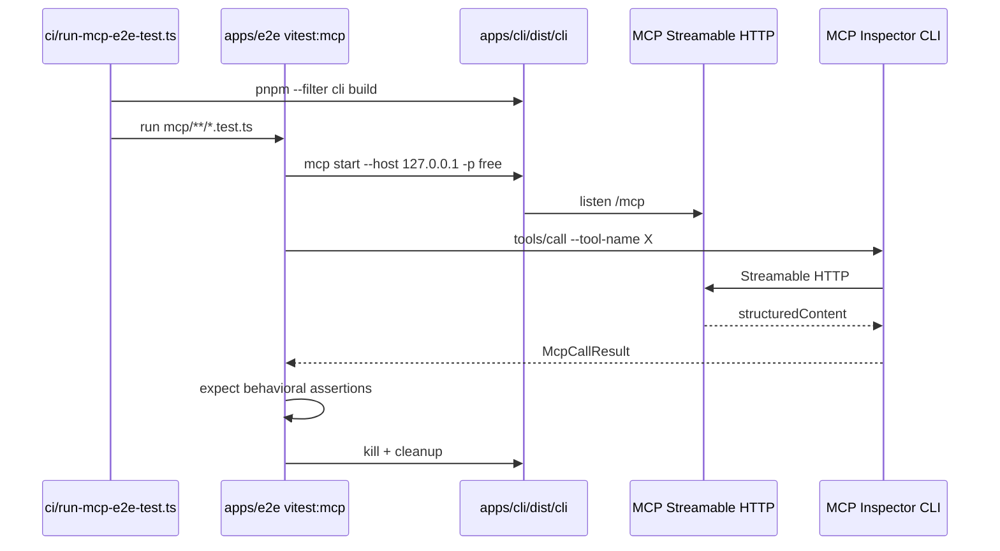

# MCP Tools Call E2E (port `test/mcp` → `apps/e2e/mcp`)

This design document describes migrating existing MCP tool call e2e coverage from
`test/mcp/` into `apps/e2e/mcp/`, with one Vitest file per tool against the built
CLI binary. It extends [2026-09-22-mcp-tools-e2e-design.md](./2026-09-22-mcp-tools-e2e-design.md)
(tools/list only) to include `tools/call` behavioral tests.

## 1. Background

`apps/e2e/mcp/` already runs Vitest against `apps/cli/dist/cli[.exe] mcp start`
and asserts an exact `tools/list` name set. Deeper per-tool `tools/call` coverage
lives under `test/mcp/` (Bun test + `bun apps/cli/index.ts`). Maintaining two
runners and two fixture stacks is costly.

Goal: lift-and-adapt existing `test/mcp/` tool tests into `apps/e2e/mcp/`, keep
assertions, delete `test/mcp/` when green. Missing tools (TVDB, `rename-episode-file`,
create-*-plan) stay out of this pass.

## 2. Architecture

### 2.1 Project Level Architecture

| Component | Role |
|-----------|------|
| `apps/cli` build | Produces `apps/cli/dist/cli[.exe]` |
| `apps/e2e/mcp` | Vitest suite: spawn MCP, Inspector `tools/list` + `tools/call` |
| `ci/run-mcp-e2e-test.ts` | Runner for Actions and local `e2e:mcp` / `e2e:mcp:bin` |
| `.github/workflows/e2e-mcp-tools.yml` | Manual multi-platform matrix (unchanged entrypoint) |
| `test/mcp/` | **Deleted** after the port is green |
| `test/mcp-test-client/` | Unrelated; kept for WDIO / manual smoke |

### 2.2 App Level Architecture

```
apps/e2e/mcp/
├── README.md
├── expectedTools.ts
├── tools-list.test.ts
├── start-stop-mcp-server-in-cli.test.ts
├── lib/
│   ├── mcpInspectorClient.ts   # listTools + callTool
│   ├── mcpServer.ts            # spawn built CLI, readiness, teardown
│   ├── useMcpServer.ts         # beforeAll/afterAll hooks
│   ├── testSetup.ts            # media fixtures, smm.json, metadata seed
│   └── tmdbTestHelpers.ts      # shared TMDB env + retry (optional extract)
└── <tool-name>.test.ts         # one file per ported tool
```

Per-tool files (this pass):

| File | Tool |
|------|------|
| `get-app-context.test.ts` | `get-app-context` |
| `get-media-folders.test.ts` | `get-media-folders` |
| `is-folder-exist.test.ts` | `is-folder-exist` |
| `list-files.test.ts` | `list-files` |
| `get-media-metadata.test.ts` | `get-media-metadata` |
| `get-episode.test.ts` | `get-episode` |
| `get-episodes.test.ts` | `get-episodes` |
| `rename-folder.test.ts` | `rename-folder` |
| `scrape.test.ts` | `scrape` |
| `get-job.test.ts` | `get-job` |
| `tmdb-search.test.ts` | `tmdb-search` |
| `tmdb-get-movie.test.ts` | `tmdb-get-movie` |
| `tmdb-get-tv-show.test.ts` | `tmdb-get-tv-show` |
| `how-to-rename-episode-video-files.test.ts` | `how-to-rename-episode-video-files` |
| `how-to-recognize-episode-video-files.test.ts` | `how-to-recognize-episode-video-files` |
| `readme.test.ts` | `readme` |

Non-tool files kept/ported: `tools-list.test.ts`, `start-stop-mcp-server-in-cli.test.ts`.

**Out of this pass:** `tvdb-*`, `rename-episode-file`, `create-rename-episode-plan`,
`create-recognize-episode-plan`.

### 2.3 Key Design

- **Lift-and-adapt:** Port assertions and fixtures from `test/mcp/`; convert Bun → Vitest (`it` → `test`).
- **Built binary only:** All tests use `mcpServer.ts` spawning `cli mcp start` (not `bun apps/cli/index.ts`).
- **Inspector CLI:** `node <launcher> --cli …` via `execFile` (never `npx` on Windows).
- **One file per tool:** Split former `tmdb-tools.test.ts` and `scrape.test.ts` (scrape + get-job).
- **Shared helpers:** `callTool`, `testSetup`, TMDB config/retry under `lib/`.
- **`get-job` setup:** May create a scrape job first; primary assertions target `get-job`.
- **Scripts:** Root `e2e:mcp` points at `bun ci/run-mcp-e2e-test.ts` (same as `e2e:mcp:bin`).
- **Knip:** Drop `test/mcp/**` entries when the tree is deleted.
- **No production MCP code changes** in this pass.

## 3. User Stories

### 3.1 Each ported tool responds to tools/call

* **Given** a freshly built `cli` binary and an isolated MCP server
* **When** the Vitest file for that tool calls Inspector `tools/call` with the same args/fixtures as the old Bun test
* **Then** assertions on `structuredContent` / error flags match the previous `test/mcp` behavior



### 3.2 tools/list exact set still holds

* **Given** the same built CLI MCP server
* **When** `tools-list.test.ts` runs
* **Then** advertised names equal `EXPECTED_MCP_TOOL_NAMES` (unchanged contract)

### 3.3 Retire Bun `test/mcp` suite

* **Given** the Vitest port is green
* **When** cleanup lands
* **Then** `test/mcp/` is deleted, `e2e:mcp` no longer runs Bun under that path, and knip/docs point at `apps/e2e/mcp`

## 4. Migration Order

1. Port `callTool` + `testSetup` into `apps/e2e/mcp/lib/`.
2. Port tool tests (static text → FS/read → rename → scrape/get-job → TMDB).
3. Port `start-stop-mcp-server-in-cli.test.ts` to the built binary.
4. Update scripts, knip, README; note supersession of tools/list-only scope.
5. Run suite green; delete `test/mcp/`.

## 5. Risks

| Risk | Mitigation |
|------|------------|
| TMDB network flakiness | Keep retry helper + long timeouts; need `TMDB_*` env |
| Windows Inspector/`npx` path mangling | `node <launcher>` + `execFile` |
| Per-file server spawn cost | Accept isolation; no shared global server this pass |

## 6. Success Criteria

- Every ported tool has `apps/e2e/mcp/<tool>.test.ts`.
- `bun ci/run-mcp-e2e-test.ts` passes (TMDB tests need existing env).
- `test/mcp/` removed; root `e2e:mcp` targets the binary runner.
- `test/mcp-test-client/` and WDIO MCP specs unchanged.
