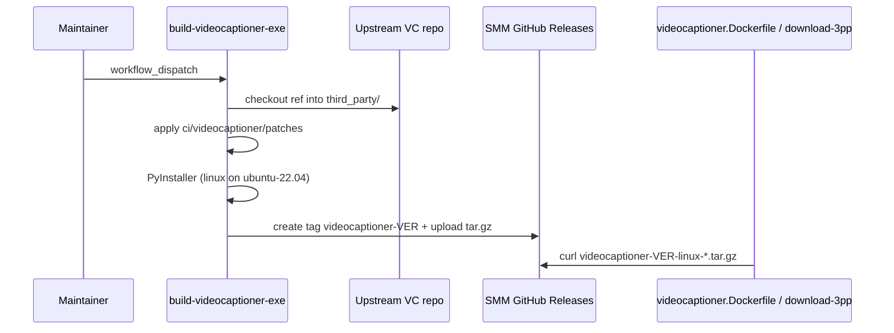

# Build VideoCaptioner executables in SMM CI (publish to SMM GitHub Releases)

This design document describe the high level design of a feature.
The design document is golden source and reference by one or more features.

## 1. Background

SMM ships VideoCaptioner as a third-party CLI under `SMM_RESOURCES_PATH` for Electron and Docker (`bin/videocaptioner/`). Today binaries are downloaded from `lawrenceching/VideoCaptioner` GitHub Releases (`3pp.videocaptioner_version`, `ci/download-3pp-binary.sh`, `apps/docker/videocaptioner.Dockerfile`).

Those linux builds were produced on Ubuntu 24.04 (`ubuntu-latest` / `ubuntu-24.04-arm`). The bundled `libpython3.12.so.1.0` requires **GLIBC_2.38+**. SMM’s Docker final image is `debian:bookworm-slim` (**glibc 2.36**), so `videocaptioner` fails at process start inside the container. Ubuntu 22.04 desktop users would hit the same class of failure.

**Goals:**
- Stop maintaining a separate repository solely for VideoCaptioner executable CI.
- Build standalone executables **without vendoring or mutating** VideoCaptioner source in git (clone + optional local patches in CI only).
- Publish artifacts on **this** repository’s GitHub Releases so Electron / Docker keep a stable download URL pattern.
- Produce **one** linux build per arch that runs on Ubuntu 22.04+, Ubuntu 24.04+, and Debian bookworm (build linux on **ubuntu-22.04**).

**Non-goals:**
- Forking or permanently vendoring VideoCaptioner source into the monorepo.
- Shipping separate Ubuntu 22 vs 24 linux artifact sets.
- Changing VideoCaptioner’s upstream product behavior beyond packaging / CI patches stored in SMM.

**Decisions (locked):**
- Approach: CI clone upstream at a pinned ref → optional `git apply` patches from SMM → PyInstaller via upstream `scripts/build_exe.py` → upload to SMM Releases.
- Publish target: GitHub Releases on the SMM repo, tag `videocaptioner-<version>`.
- Asset names stay `videocaptioner-<version>-<platform-arch>.tar.gz` (same suffixes as today: `linux-x64`, `linux-arm64`, `win-x64`, `win-arm64`, `mac-arm64`).

## 2. Architecture

## 2.1 Project Level Architecture

```
package.json 3pp
  videocaptioner_version  ──► Release tag + asset version string
  videocaptioner_ref      ──► git checkout of upstream source
  videocaptioner_repo     ──► which GitHub repo to clone (source only)

.github/workflows/build-videocaptioner-exe.yml
  matrix runners ──► clone + patch + PyInstaller ──► artifacts
       │
       └─► gh release create/upload
              tag: videocaptioner-<version>
              assets: videocaptioner-<version>-*.tar.gz

ci/download-3pp-binary.sh
apps/docker/videocaptioner.Dockerfile
  ── download from SMM repo Releases (not upstream Releases)

.github/workflows/build-videocaptioner.yml  (existing)
  ── still builds GHCR smm-videocaptioner image from downloaded tarball
```

- **Source of truth for “which upstream commit”:** `3pp.videocaptioner_ref` (tag or full SHA).
- **Source of truth for “which SMM-packaged binary version”:** `3pp.videocaptioner_version` (may differ from upstream version; used in `--version` and asset names).
- **Patches (optional):** `ci/videocaptioner/patches/*.patch` applied only in the CI workspace; never pushed to upstream.
- **GPL-3.0:** Release notes must name `videocaptioner_repo@videocaptioner_ref` so Corresponding Source is identifiable.

Related designs: [docker-3pp-images](../design/docker-3pp-images/design.md), [docker-hub-publish](./2026-08-01-docker-hub-publish-design.md).

## 2.2 App Level Architecture

### `package.json` → `3pp`

| Key | Role |
|-----|------|
| `videocaptioner_version` | SMM artifact version; Release tag `videocaptioner-<this>`; PyInstaller `--version`; asset filename version segment |
| `videocaptioner_ref` | Upstream git ref to clone (tag or SHA) |
| `videocaptioner_repo` | Upstream GitHub `owner/repo` to clone (default e.g. `lawrenceching/VideoCaptioner` or agreed fork) |

Download URL base (consumers):

```text
https://github.com/<SMM_OWNER>/<SMM_REPO>/releases/download/videocaptioner-<version>/videocaptioner-<version>-<suffix>.tar.gz
```

### New workflow: `.github/workflows/build-videocaptioner-exe.yml`

- **Trigger:** `workflow_dispatch` (manual). Optional later wiring into release pipelines is out of initial scope unless needed.
- **Permissions:** `contents: write` (create/upload release).
- **Matrix:**

| target | runner |
|--------|--------|
| `win-x64` | `windows-latest` |
| `win-arm64` | `windows-11-arm` (or current GH equivalent) |
| `linux-x64` | **`ubuntu-22.04`** |
| `linux-arm64` | **`ubuntu-22.04-arm`** (or documented equivalent if unavailable) |
| `mac-arm64` | `macos-latest` |

- **Steps (per matrix job):**
  1. Checkout SMM (for patches + version metadata).
  2. Checkout `videocaptioner_repo` at `videocaptioner_ref` into `third_party/videocaptioner` (do not commit this tree).
  3. Apply `ci/videocaptioner/patches/*.patch` with `git apply` (no-op if none).
  4. Setup Python 3.12; `pip install pyinstaller`; `pip install -e .` in the VC tree.
  5. `python scripts/build_exe.py --clean --version <videocaptioner_version>`.
  6. Pack `dist/videocaptioner/` → `videocaptioner-<ver>-<target>.tar.gz`; upload job artifact.

- **Release job (needs all matrix jobs):**
  - Download artifacts; `gh release create videocaptioner-<ver> …` (or upload if tag exists when force-rebuild is requested).
  - Body includes upstream pin, license, and linux runner note (`ubuntu-22.04` for glibc ≤ bookworm).

### Consumer updates

- **`ci/download-3pp-binary.sh`:** Point VideoCaptioner downloads at the SMM repository Releases URL (`videocaptioner-<version>` tag). Stop using `VIDEOCAPTIONER_REPO` as the **binary** host (that env/key remains only for documenting/cloning source, or is renamed for clarity: e.g. keep `videocaptioner_repo` as source clone; download host is always `github.repository`).
- **`apps/docker/videocaptioner.Dockerfile`:** Same URL change when curling the tarball.
- **`ci/docker-image-coords.sh` / docs:** Expose new `3pp` keys if scripts already echo versions.
- **Existing `build-videocaptioner.yml`:** Unchanged purpose (GHCR image from tarball); inherits new download source via Dockerfile.

### Patch layout

```text
ci/videocaptioner/
  patches/          # optional *.patch; empty initially
  README.md         # how to refresh ref, add patches, run workflow
```

## 2.3 Key Design

1. **Glibc floor via runner, not dual artifacts:** linux builds on Ubuntu 22.04 so one binary covers bookworm / Ubuntu 22 / Ubuntu 24.
2. **Ephemeral source:** clone only in CI; monorepo never stores VC source.
3. **Patches are SMM-owned escape hatch:** packaging/build fixes live as patch files; upstream upgrades are `videocaptioner_ref` bumps + patch refresh if needed.
4. **Stable consumer contract:** asset naming unchanged; only the GitHub owner/repo and release **tag** form change (`videocaptioner-<ver>` instead of bare `<ver>` on the old repo).

## 3. User Stories

### 3.1 Maintainer publishes a new VideoCaptioner binary set

* **Given** `3pp.videocaptioner_version` / `videocaptioner_ref` / `videocaptioner_repo` are set in `package.json`
* **When** maintainer runs `build-videocaptioner-exe` workflow
* **Then** SMM Release `videocaptioner-<version>` exists with five platform archives, and linux-x64 runs on `debian:bookworm-slim` (`videocaptioner --version` succeeds)



### 3.2 Electron / Docker packaging consumes SMM-hosted binaries

* **Given** Release assets are published
* **When** `download-3pp-binary.sh` or `videocaptioner.Dockerfile` runs for a platform
* **Then** it fetches from SMM Releases using `videocaptioner_version` and extracts to `bin/videocaptioner/` (layout unchanged)

### 3.3 Optional CI-only source patch without touching upstream

* **Given** a packaging fix is needed in VC tree
* **When** maintainer adds `ci/videocaptioner/patches/0001-….patch` and re-runs the exe workflow
* **Then** the built artifact includes the fix, and the upstream git repository is unchanged

## 4. Acceptance criteria

- [ ] New workflow builds all five targets; linux runners are 22.04-based.
- [ ] Release tag + asset naming match this spec; notes cite `repo@ref` and GPL-3.0.
- [ ] `download-3pp-binary.sh` and `videocaptioner.Dockerfile` download from SMM Releases.
- [ ] `3pp` gains `videocaptioner_ref` (and `videocaptioner_repo` if not already wired for clone).
- [ ] Bookworm smoke: extracted linux-x64 `videocaptioner --version` does not fail on `GLIBC_2.38`.
- [ ] No VideoCaptioner source tree committed to SMM.

## 5. Out of scope / follow-ups

- Automating exe build on every SMM release tag (can call this workflow later).
- Migrating historical assets from `lawrenceching/VideoCaptioner` Releases (consumers switch on version bump).
- Changing ASR/runtime behavior of VideoCaptioner itself.
