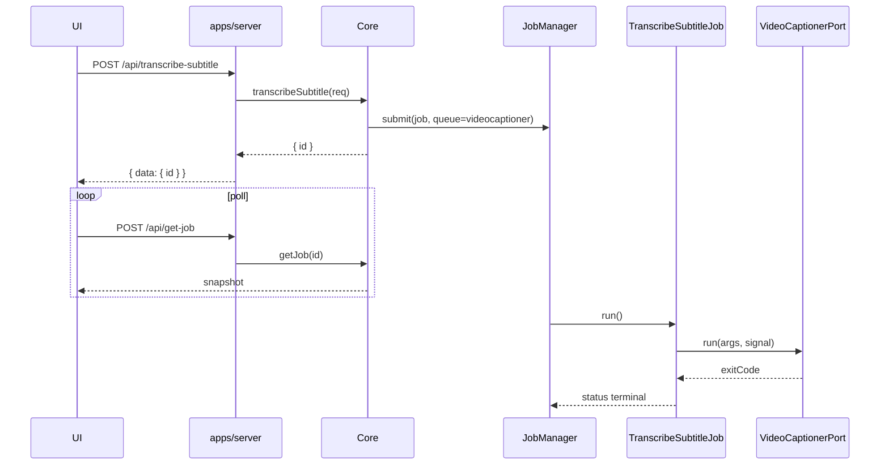

# TranscribeSubtitleJob + TranslateSubtitleJob

This design document describe the high level design of a feature.
The design document is golden source and reference by one or more features.

## 1. Background

生成字幕（transcribe）与翻译字幕（translate）今天跑在 UI 的 `JobOrchestratorProvider`：对话框经 IndexedDB 入队，Orchestrator 用 `executeCmd` 调 `videocaptioner`，进度与 stop 绑在 IDB + command-log 轮询上。下载视频已迁到 Core `YtdlpJob` + `CommandPort` + HTTP/UI 快照镜像；字幕两条路径仍停留在浏览器编排层。

本设计把 **transcribe** 与 **translate** 按 `YtdlpJob` 模式迁到 Core：独立 `AbstractJob`、专用 Port、专用队列、HTTP 入队、UI 读 Core 快照。`synthesize` / `process` / ffmpeg 仍留在 Orchestrator，不在本轮范围。

**Constraints (product decision):**

- Scope: `TranscribeSubtitleJob` + `TranslateSubtitleJob`；`VideoCaptionerPort`；HTTP 入队 + 现有 `get-job` / `get-jobs` / `get-job-log` / `stop-job`；UI 对话框与后台任务面板切到 Core；CLI `smm transcribe` / `smm translate`。
- Provider: Core 路径 **只支持 VideoCaptioner**。`tencentAsr` 本轮不迁；对话框对本期隐藏或禁用该 provider（feature flag 默认关则改动最小）。
- Out of scope: `synthesize`、`process`、ffmpeg 相关后台任务、腾讯 ASR 云端转写、VC 中间进度解析。
- Storage: 与现有 Core Job 相同——进程内内存，进程退出即丢。
- Progress: `running` 时 0，成功 100；不解析 videocaptioner 中间进度。
- Secrets: LLM `apiKey` 可进 argv 跑命令，**不得**进入 `toJSON()` 快照或 UI 镜像字段。

## 2. Architecture

### 2.1 Project Level Architecture

```
UI / CLI
  → Core.transcribeSubtitle / translateSubtitle
  → JobManager.submit(…, { queue: "videocaptioner", timeoutMs: 10min })
  → TranscribeSubtitleJob | TranslateSubtitleJob
  → VideoCaptionerPort.run({ args, signal, onStdoutLine?, onStderrLine? })
  → apps/server 适配器（复用 runCommand：解析 videocaptioner、命令日志、Abort）
```

| 层 | 职责 |
|----|------|
| `apps/core` | Job 类、白名单 argv builder、`VideoCaptionerPort` 接口、Core 公开方法、JobManager 新队列 |
| `apps/server` | Port 适配器；`POST /api/transcribe-subtitle`、`/api/translate-subtitle`；序列化新 kind |
| `apps/cli` | `smm transcribe` / `smm translate`（本进程 Core，等 Job 结束 exit 0/1） |
| `apps/ui` | 对话框调 Core HTTP；Zustand 镜像 Core 快照；删 Orchestrator transcribe/translate 分支 |
| Orchestrator | 保留 synthesize / process / ffmpeg；不再处理 transcribe / translate |

依赖方向不变：`apps/cli → apps/server → apps/core`。UI 仍经 Hono RPC / 现有 poll 客户端调用 server，**不得**从浏览器 import `@smm/core` 根入口（`node:events`）。

### 2.2 App Level Architecture

| Piece | Location | Role |
|--------|----------|------|
| `VideoCaptionerPort` | `apps/core/src/ports/VideoCaptionerPort.ts` | 只跑 videocaptioner；与 `CommandPort` 并列 |
| `whitelistedCmd/videocaptioner.ts` | `apps/core` | 从 UI `buildTranscribeArgs` / `buildTranslateArgs` 迁入的 argv builder + 校验 |
| `TranscribeSubtitleJob` | `apps/core/src/jobs/TranscribeSubtitleJob.ts` | `AbstractJob`；kind `transcribe-subtitle` |
| `TranslateSubtitleJob` | `apps/core/src/jobs/TranslateSubtitleJob.ts` | `AbstractJob`；kind `translate-subtitle` |
| Job snapshot types | `apps/core/src/jobs/types.ts` | 并入 `Job` 联合 |
| `JobQueueName` | `jobManager.ts` | 新增 `"videocaptioner"`，并发 1 |
| `Core.transcribeSubtitle` / `translateSubtitle` | `Core.ts` + pipeline API 模块 | 入队立即返回 `{ id }` |
| Server Port 适配 | `apps/server/src/core/` | 注入 `videoCaptioner` Port；复用现有 `runCommand` |
| HTTP routes | `apps/server/src/route/` | `TranscribeSubtitle.ts`、`TranslateSubtitle.ts`；`serializeJob` 扩 kind |
| CLI | `apps/cli/src/cli/commands/` | `smm transcribe`、`smm translate` |
| UI APIs / stores | `apps/ui` | 入队 API、镜像 store、对话框、后台任务项；删 IDB factory 路径 |

删除或降级仅被 Orchestrator transcribe/translate 使用的 `transcribeJobFactory` / `translateJobFactory`（若无其它引用则删）。

### 2.3 Key Design

#### VideoCaptionerPort

不扩展 `CommandPort`（其 `command` 仅 `"yt-dlp"`）。新建：

```ts
export interface VideoCaptionerRunRequest {
  args: string[];
  onStdoutLine?: (line: string) => void;
  onStderrLine?: (line: string) => void;
}

export interface VideoCaptionerRunResult {
  exitCode: number;
  stdout: string;
  stderr: string;
}

export interface VideoCaptionerPort {
  run(request: VideoCaptionerRunRequest, signal: AbortSignal): Promise<VideoCaptionerRunResult>;
}
```

`PlatformPorts` / `PlatformPortsInput` 增加可选 `videoCaptioner?: VideoCaptionerPort`。缺 Port 时 Core 方法返回业务错误（与缺 `command` 时 download 行为一致）。

Server 适配器解析主机上的 `videocaptioner` 可执行文件、写 command log、把 `AbortSignal` 传到子进程；**不**拼业务 argv——argv 由 Core 白名单 builder 生成。

#### JobManager 队列

```ts
export type JobQueueName = "default" | "ytdlp" | "videocaptioner";
```

- `videocaptioner` 队列并发 **1**（与现 Orchestrator per-type 并发 1 对齐，且避免两台 VC 进程抢同一可执行文件/GPU）。
- 默认 `timeoutMs`: **10 分钟**（对齐 Orchestrator `JOB_TIMEOUT_MS` 的 `transcribe` / `translate`）。
- 不占用 `default` / `ytdlp` 槽位。

#### 双 Job（scheme 1）

两个独立 `AbstractJob` 子类，共用 Port 与队列，各自 snapshot 与入队 API。不合成单一「SubtitleJob」带 mode 字段——与 `YtdlpJob` 一任务一类保持一致，HTTP/CLI/UI kind 判别更清晰。

**abort**：`tryAbort` 设标志并 abort 当前 `AbortController`；`VideoCaptionerPort.run` 收到 signal 后杀进程。

**日志**：stdout/stderr 行写入 Core job log（路径与现有 `AbstractJob` / `YtdlpJob` 相同）。UI 用现有 `get-job-log`。不再以 IDB `executionId` 轮询作为主路径。

**进度**：`progress()` 在 `running` 返回 0，`succeeded` 返回 100；失败/中止保持约定（与现转写 UI 行为一致即可）。

#### Core 方法与请求体

```ts
core.transcribeSubtitle(req) → { id }
core.translateSubtitle(req)  → { id }
```

请求体（VideoCaptioner only）：

| 方法 | 字段 |
|------|------|
| Transcribe | `folder`, `mediaPath`, `title?`, `asr`, `language?`, `wordTimestamps?`, `format?` |
| Translate | `folder`, `subtitlePath`, `mediaPath?`, `title?`, `translator`, `targetLanguage`, `reflect?`, `layout?`, `llm?`（`apiKey` / `apiBase` / `model`） |

路径：调用方传**宿主平台绝对路径**（与今天 `mediaPathPlatform` / `subtitlePathPlatform` 一致）。Core 不做 POSIX↔平台路径转换。

argv 规则从现 Orchestrator 迁入（含 dummy `--api-key` 在 VC 需要时注入、LLM 时真实 key、`--no-optimize` / `--no-split` 等 translate 默认）。非法选项在 Job 内失败并写 `error`，不 spawn。

#### 快照

并入 `Job` 联合：

```ts
kind: "transcribe-subtitle" | "translate-subtitle"
type: 同上
status, progress, error?, createdAt, updatedAt
+ 业务字段（folder, mediaPath / subtitlePath, title?, asr / translator, …）
```

快照**不含**任何 `llm` 密钥或连接细节（`apiKey` / `apiBase` / `model` 均不进 `toJSON()`）。翻译选项仅暴露非敏感字段（如 `translator`、`targetLanguage`、`reflect`、`layout`）。

#### HTTP

判别联合 `{ data } | { error }`；HTTP 200 承载业务结果（与项目 API 指南一致）。

| 方法 | 路径 | 成功体 |
|------|------|--------|
| POST | `/api/transcribe-subtitle` | `{ data: { id } }` |
| POST | `/api/translate-subtitle` | `{ data: { id } }` |
| 现有 | `get-job` / `get-jobs` / `get-job-log` / `stop-job` | 序列化 / 停止新 kind |

路由加入 `createApp()` 的 `.route()` 链；`serializeJob` 与 `GetJobs` 过滤覆盖新 kind。`/api/get-job` 继续在 access-log skip 集合中（已有）。

#### CLI

```bash
smm transcribe <media> --folder <path> [--asr …] [--language …] [--format srt] [--word-timestamps] [--title …]
smm translate <subtitle> --folder <path> --translator bing|google|llm --target-language <lang> \
  [--reflect] [--layout …] [--api-key …] [--api-base …] [--model …] [--title …] [--media …]
```

行为：本进程 Core 入队 → 轮询直到终态 → exit 0（succeeded）/ 1（failed|aborted|error）。可选 `--verbose` 打印 job log。不做 CLI 连远端 daemon。

#### UI 切换

- `TranscribeDialog` / 翻译对话框：Confirm 后对每个选中项调上述 HTTP，不再 `createJob` 写 IndexedDB。
- 后台任务列表：Core 快照镜像进 Zustand（对齐 `YtdlpBackgroundJob` 模式）；进度/停止走 `get-job` 轮询 + `stop-job`。
- MusicPanel（及同类行状态）：读 Core 镜像的 transcribe/translate job。
- `JobOrchestratorProvider`：删除 `case 'transcribe'` / `case 'translate'` 及仅被它们使用的 `buildTranscribeArgs` / `buildTranslateArgs` 与超时表项；保留 synthesize / process。
- tencentAsr：本期禁用 Confirm 或隐藏 provider；不保留「半条旧 Orchestrator 路径」。

## 3. User Stories

### 3.1 UI 生成字幕经 Core 入队

* **Given** - 媒体文件夹已选，VideoCaptioner 可用，用户在 Transcribe 对话框选中若干文件并 Confirm
* **When** - UI 对每个文件 `POST /api/transcribe-subtitle`
* **Then** - 每个请求返回 `{ data: { id } }`；后台任务列表出现 `kind: "transcribe-subtitle"`；Job 结束后状态为 succeeded 或 failed，进度 100 或带 error；Orchestrator / IDB 不再出现对应 transcribe record



### 3.2 UI 翻译字幕经 Core 入队

* **Given** - 用户在翻译对话框选定字幕与 translator / target language
* **When** - UI `POST /api/translate-subtitle`
* **Then** - 返回 job id；快照 `kind: "translate-subtitle"`；LLM key 不出现在 `get-job` 响应；用户可 `stop-job` 中止

### 3.3 停止正在运行的字幕 Job

* **Given** - 一个 `transcribe-subtitle` 或 `translate-subtitle` Job 处于 `pending` 或 `running`
* **When** - `POST /api/stop-job` with that id
* **Then** - Job 变为 `aborted`；子进程被 AbortSignal 打断；队列可运行下一个 videocaptioner Job

### 3.4 CLI 转写并等待

* **Given** - 本机已配置 videocaptioner，假或真 Port 可跑
* **When** - `smm transcribe ./a.mp4 --folder ./lib --asr bijian`
* **Then** - 进程阻塞至终态；succeeded 时 exit 0，否则 exit 1

### 3.5 Orchestrator 不再跑 transcribe/translate

* **Given** - 迁移完成的 UI
* **When** - 用户只做生成/翻译字幕
* **Then** - `JobOrchestratorProvider` 不 spawn videocaptioner 做 transcribe/translate；synthesize/process 仍可走 Orchestrator

## 4. Testing

| 层 | 要点 |
|----|------|
| Core unit | 假 `VideoCaptionerPort`：argv 形状、exit≠0 → failed、abort → aborted、快照无 apiKey |
| JobManager | `videocaptioner` 与 `ytdlp` / `default` 互不阻塞；并发 1 |
| HTTP | 入队返回 id；`get-job` kind 正确；`stop-job` 可中止；缺字段 → `{ error }` |
| UI | 对话框 mock Core API；Orchestrator 测试不再覆盖 transcribe/translate 执行分支 |
| CLI | 假 Port 下 exit 0 / 1 |

红绿原则：暂时破坏生产逻辑确认测试失败信息符合预期后再恢复。

## 5. Documentation

- 更新 [docs/dev/job.md](../../dev/job.md)：新 kind、队列、`stop-job` 行为。
- 新增或扩写 `docs/dev/transcribe-translate-subtitle.md`（可选，若 job.md 已足够可只改 job.md + 本 design）。
- 更新 [docs/api/index.md](../../api/index.md)：两条新 POST 路由。

## 6. Non-Goals (explicit)

- 不把 synthesize / process 迁到 Core。
- 不实现 tencentAsr Core Job。
- 不解析 videocaptioner 百分比进度条。
- 不持久化 Job 跨进程。
- 不让浏览器依赖 `@smm/core` 根 barrel。
